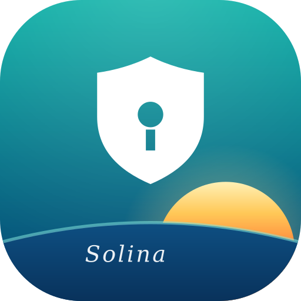

# Solina Password Manager

<p align="center">
  
</p>

> گاوصندوق دیجیتال متن‌باز برای اندروید: رمزهای عبور، کدهای احراز هویت دومرحله‌ای و اطلاعات محرمانه، فقط در اختیار خودتان.

## ⚠️ هشدار مهم

**نسخهٔ ۱٫۰٫۰ اولین انتشار عمومی است، ولی برنامه هنوز در مرحلهٔ پیش‌آلفاست و بازبینی امنیتی مستقل ندارد.** تا زمانی که نسخهٔ پایدار و بازبینی‌شده منتشر نشود، از Solina برای نگهداری رمزهای واقعی استفاده نکنید.

## نصب

آخرین نسخه را از صفحهٔ [Releases](https://github.com/Solina-Projects/Solina-Password-Manager/releases) دانلود کنید — فایل APK را نصب کنید.

- نیازمند اندروید ۸٫۰ (API 26) یا بالاتر
- بدون نیاز به حساب کاربری؛ همهٔ داده‌ها فقط روی گوشی شما می‌مانند

## چرا Solina؟

- **Zero-Knowledge:** همهٔ داده‌ها روی دستگاه شما و پیش از هر ارسال یا ذخیره رمزگذاری می‌شوند. سرور یا سرویس ابری هیچ‌وقت متن ساده نمی‌بیند.
- **بدون وابستگی اجباری به حساب:** بدون Google و GitHub هم کامل کار می‌کند. ورود با این حساب‌ها فقط یک امکان اختیاری است و جای رمز اصلی را نمی‌گیرد.
- **همه‌چیز در یک اپ:** مدیر رمز، Authenticator (TOTP/HOTP)، کارت و هویت و یادداشت امن.
- **فارسی‌محور:** رابط کاملاً RTL، تقویم جلالی، فونت وزیرمتن، و در عین حال انگلیسی کامل.
- **بدون تبلیغ و ردیاب:** بدون Analytics، بدون SDK تبلیغاتی، و بدون ارتباط شبکه‌ای پنهان.
- **متن‌باز و قابل بررسی:** کد، مستندات امنیتی و تصمیم‌های معماری همه عمومی هستند.

## قابلیت‌ها

| حوزه | شرح |
|---|---|
| خزانه | ورودی‌های Login، کارت بانکی، هویت، یادداشت امن، جست‌وجوی سریع، دسته‌بندی و فیلتر بر اساس دسته، تاریخچهٔ تغییرات |
| Authenticator | TOTP و HOTP، اسکن QR، کدهای چرخان با حلقهٔ شمارش نرم |
| Autofill | Android Autofill با تأیید دامنه و اپ برای جلوگیری از فیشینگ، پیشنهاد ذخیرهٔ رمز جدید |
| امنیت | Argon2id، AES-256-GCM، Android Keystore، بیومتریک، قفل خودکار، محافظت از اسکرین‌شات و کلیپ‌بورد |
| بکاپ و ایمپورت | فایل رمزگذاری‌شده، عبارت بازیابی ۲۴ کلمه‌ای، ایمپورت از Aegis و 2FAS و Bitwarden و Proton Pass و andOTP و Raivo و CSV |
| همگام‌سازی | اختیاری و رمزگذاری‌شده، با انتخاب محل ذخیره (Google Drive، WebDAV، پوشهٔ محلی) |
| مرکز امنیت | تشخیص رمز ضعیف، تکراری و HTTP ناامن، و بررسی اختیاری افشا با روش k-anonymity |
| رابط کاربری | Jetpack Compose و Material 3، انیمیشن‌های نرم (فیلتر لغزنده، کد چرخان، نوار قدرت پلکانی) |

## مستندات

| فایل | محتوا |
|---|---|
| [`docs/ARCHITECTURE.md`](docs/ARCHITECTURE.md) | معماری، سلسله‌مراتب کلید، فرمت داده و بکاپ، مدل تهدید، استراتژی تست |
| [`docs/VAULT.md`](docs/VAULT.md) | طراحی خزانه (فاز ۵): سلسله‌مراتب کلید، PIN، بکاپ، یادداشت/کارها و موارد ناتمام — مطابق کد |
| [`docs/THREAT_MODEL.md`](docs/THREAT_MODEL.md) | مدل تهدید به‌روز شامل فازهای ۱ تا ۴: چه چیزی محافظت می‌شود و چه چیزی نمی‌شود |
| [`docs/SELF_REVIEW.md`](docs/SELF_REVIEW.md) | بازبینی صادقانهٔ خود (فاز ۵): وضعیت CI و تست‌ها، ریسک‌های باز، چک‌لیست آمادگی ممیزی |
| [`docs/DESIGN.md`](docs/DESIGN.md) | زبان بصری، توکن‌های رنگ و تایپوگرافی، طراحی صفحه‌ها، RTL، دسترس‌پذیری |
| [`docs/MASTER_PROMPT.md`](docs/MASTER_PROMPT.md) | نقشهٔ راه مرحله‌ای و دستورالعمل توسعه |
| [`SECURITY.md`](SECURITY.md) | سیاست گزارش آسیب‌پذیری |

## نقشهٔ راه

`M0` تحقیق و مستندات ← `M1` زیرساخت ← `M2` هستهٔ امنیتی ← `M3` خزانه ← `M4` Autofill ← `M5` Authenticator ← `M6` بکاپ و ایمپورت ← `M7` سخت‌سازی و بتا ← `M8` همگام‌سازی

مرحله‌های M0 تا M8 انجام شده‌اند و نسخهٔ ۱٫۰٫۰ منتشر شده است. جزئیات و معیار پذیرش هر مرحله در `docs/MASTER_PROMPT.md` است.

بعد از ۱٫۰ (نقشهٔ راه تاییدشدهٔ ۲۰۲۶-۱۱-۲۰): سطل زباله، برچسب‌های چندگانه، پرچم «رمز قدیمی»، تفاوت تاریخچه، سنجش قدرت رمز در ویرایش، تکثیر ورودی، علاقه‌مندی اول در Autofill و پنهان‌کردن کد TOTP تا زمان لمس پیاده شده‌اند؛ قفل با PIN، بکاپ زمان‌بندی‌شده و بخش «یادداشت و کارها» هم پیاده شده‌اند. فراخوانی زندهٔ Passkey (نیاز به دامنه و Digital Asset Links دارد)، پیوست فایل و چند خزانه هنوز کامل نشده‌اند و در نقشهٔ راه با برچسب «در نقشه راه» مشخص‌اند، نه به‌عنوان قابلیت موجود.

فاز ۴ (۲۰۲۶-۱۱-۲۰، شاخهٔ `audit/security-hardening`، هنوز منتشر نشده):
- فیلدهای سفارشی `{label, value, hidden}` برای همهٔ نوع‌های ورودی (داخل blob رمز می‌شوند؛ مقدار پنهان تا لمس پوشیده می‌ماند).
- آیکون خودکار سرویس (جدول داخلی آفلاین، بدون شبکه/دانلود) + تراکم فهرست معمولی/فشرده/کاشی‌ها در تنظیمات.
- فهرست آفلاین رمزهای رایج (~۳۷۰ مورد) با پرچم جداگانهٔ «رایج» در تحلیل امنیتی؛ هیچ رمزی برای این بررسی از دستگاه خارج نمی‌شود.
- کد ۵حرفی Steam Guard + ایمپورتر maFile استیم؛ Battle.net و Duo ایمپورتر ندارند (قالب خروجی مستند و آفلاین ندارند).
- اسکن کارت بانکی انجام نشد (نیاز به OCR دارد؛ فقط ZXing در پروژه است).
- پیوست رمزگذاری‌شده: فقط لایهٔ رمزنگاری (`AttachmentCrypto`، DEK جداگانه برای هر فایل) آماده است؛ به خزانه و بکاپ وصل نشده و در بکاپ v1 نیست (بکاپ v1 بدون تغییر خوانده می‌شود).
- چند خزانه به‌تعویق افتاد (طراحی در `MultiVaultDesign.kt`)؛ خزانهٔ فعلی بدون مهاجرت، «پیش‌فرض» می‌ماند.

فاز ۵ (۲۰۲۶-۱۱-۲۰، شاخهٔ `audit/security-hardening`): فقط مستندات و بازبینی — بدون تغییر رفتار اپ: سند طراحی خزانه `docs/VAULT.md`، به‌روزرسانی `docs/THREAT_MODEL.md`، بازبینی صادقانهٔ خود `docs/SELF_REVIEW.md` (وضعیت CI: Build شمارهٔ 44712753642 و Security شمارهٔ 44712753671 روی سرشاخهٔ `d78a9d6` سبز؛ ۲۶۵ تست واحد، ۰ خطا) و تازه‌سازی README و `SECURITY.md`. ممیزی مستقل بیرونی هنوز انجام نشده و هشدار پیش‌آلفا سر جایش است.

## ساخت از روی کد

```sh
gradle :app:assembleDebug
```

نیازمند Gradle 8.10.2 و Java 17. خروجی: `app/build/outputs/apk/debug/app-debug.apk`

## مشارکت

در این مرحله بیشترین کمک شما بازبینی طراحی است: مدل تهدید، سلسله‌مراتب کلید و تصمیم‌های رمزنگاری. لطفاً پیش از ارسال Pull Request یک Issue باز کنید. هر تغییر در بخش رمزنگاری باید با تست‌وکتور همراه باشد.

## مجوز

این پروژه تحت **GNU General Public License v3.0 (GPL-3.0)** منتشر می‌شود؛ متن کامل در فایل [`LICENSE`](LICENSE) آمده است.

## گزارش آسیب‌پذیری

لطفاً مشکلات امنیتی را در Issue عمومی گزارش نکنید. روش گزارش در [`SECURITY.md`](SECURITY.md) آمده است.

---

## English summary

**Solina** is an open-source, native Android password manager with a built-in TOTP/HOTP authenticator, built on a zero-knowledge, client-side-encrypted design (Argon2id + AES-256-GCM, Android Keystore, 24-word recovery phrase). It works fully offline and without any account; Google/GitHub sign-in is optional and never replaces the master password. UI: Jetpack Compose + Material 3, Persian (RTL) and English.

**Status:** version 1.0.0 is the first public release, but the app is still pre-alpha quality with no independent security audit yet. Do not store real secrets in any build yet. See `docs/` for architecture, design and roadmap.


## قابلیت‌های کامل نسخهٔ جدید (Solina Password Manager & Authenticator)

- **مدیریت جامع خزانه (Zero-Knowledge E2EE):**
  - انواع ورودی: **ورود (Login)**، **کارت بانکی (Card)** (همراه با نام بانک و PIN)، **هویت و نشانی (Identity)** (نام، ایمیل، تلفن، کد ملی، شرکت، نشانی، شهر، کد پستی، کشور) و **یادداشت امن (Note)**.
  - دسته‌بندی سفارشی، آیکون اختصاصی، علاقه‌مندی‌ها، تاریخ ایجاد و آخرین ویرایش، تاریخچهٔ رمزشده (تا ۱۰ نسخه) و جست‌وجوی سریع.
  - تحلیل سلامت رمزها (ضعیف، تکراری، HTTP ناامن) + **بررسی اختیاری افشای رمز عبور (HaveIBeenPwned k-Anonymity)** با ارسال صرفاً ۵ کاراکتر اول SHA-1 روی HTTPS.
- **Android Autofill Framework + Inline Suggestions (اندروید ۱۱ به بالا):**
  - تکمیل خودکار امن اطلاعات ورود با تطبیق دقیق دامنه (`TrustedBrowsers`)، مسدودسازی `http://` ناامن و نمایش پیشنهادهای Inline در کیبورد (با fallback خودکار به Dropdown در اندروید ۸ تا ۱۰).
- **Authenticator داخلی کامل (TOTP + HOTP):**
  - پشتیبانی از **TOTP (RFC 6238)** و **HOTP (RFC 4226)** با کدهای ۶ و ۸ رقمی (SHA1/SHA256/SHA512)، شمارش معکوس زنده، افزایش شمارندهٔ HOTP، اسکن QR (دوربین و گالری)، ورود دستی، دسته‌بندی و جست‌وجو.
  - ورود از **Google Authenticator (Migration QR — TOTP & HOTP)**، **Aegis (با گروه‌ها و HOTP)**، **2FAS**، **andOTP**، **Bitwarden**، **Proton Pass**، **KeePass**، **LastPass**، **Chrome/Firefox CSV**.
  - **بکاپ جداگانهٔ رمزشدهٔ Authenticator** (`solina-authenticator-*.slnb`) + اعتبارسنجی هدر بکاپ پیش از بازیابی (`Backup.inspect`).
- **همگام‌سازی E2EE و حساب‌های خارجی اختیاری:**
  - همگام‌سازی فایل‌های تغییرناپذیر احرازشده (HMAC-SHA256 + مانیفست امضاشده ضد Rollback) از طریق **SAF Folder** (فضای ابری یا حافظهٔ محلی) و **HTTPS-only WebDAV** (Nextcloud / OwnCloud).
  - اتصال اختیاری چندحسابی **Google (OIDC)** و **GitHub** با **OAuth 2.0 + PKCE (RFC 7636)**، کاملاً ایزوله از کلیدهای خزانه و با امکان قطع اتصال امن.
  - تغییر رمز اصلی (`verifyAndChangePassword`) و پاک‌سازی امن خزانهٔ محلی (Sign-Out & Secure Wipe).
- **رابط کاربری مدرن Material 3:**
  - تم‌های **سیستم / روشن / تاریک / مشکی خالص AMOLED** و پشتیبانی دوزبانه **فارسی (RTL)** و **انگلیسی (LTR)**.
- **مستندات فنی و تحلیل پروژه‌های مرجع:**
  - [`docs/REFERENCE_ANALYSIS.md`](docs/REFERENCE_ANALYSIS.md) (بررسی مجوزها و الگوهای Bitwarden، Proton Pass، Ente و Aegis)
  - [`docs/ARCHITECTURE.md`](docs/ARCHITECTURE.md) (معماری Clean Architecture + MVVM و سلسله‌مراتب کلیدها)
  - [`docs/THREAT_MODEL.md`](docs/THREAT_MODEL.md) (مدل تهدید و کنترل‌های امنیتی)
